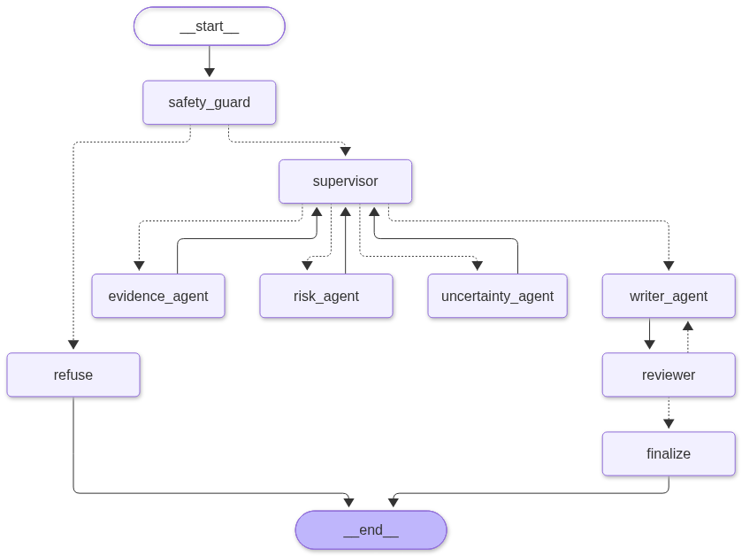
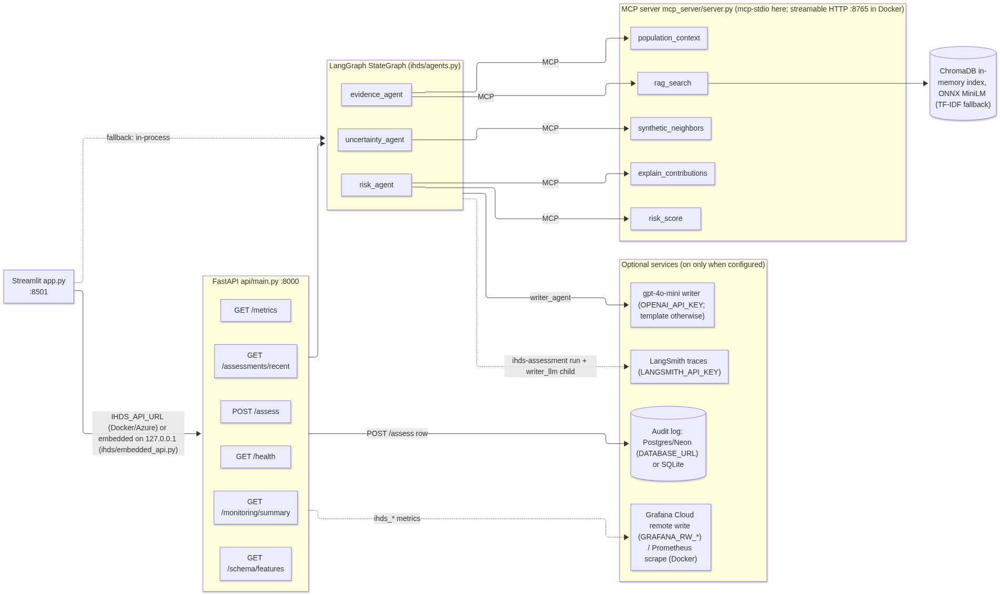
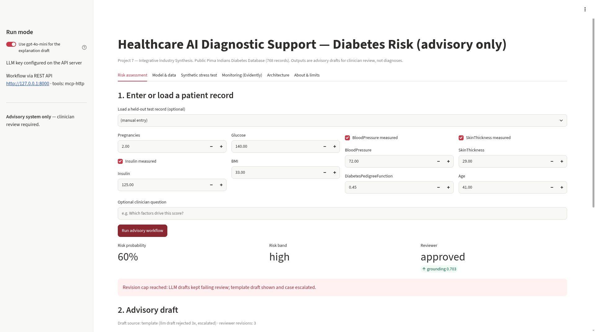
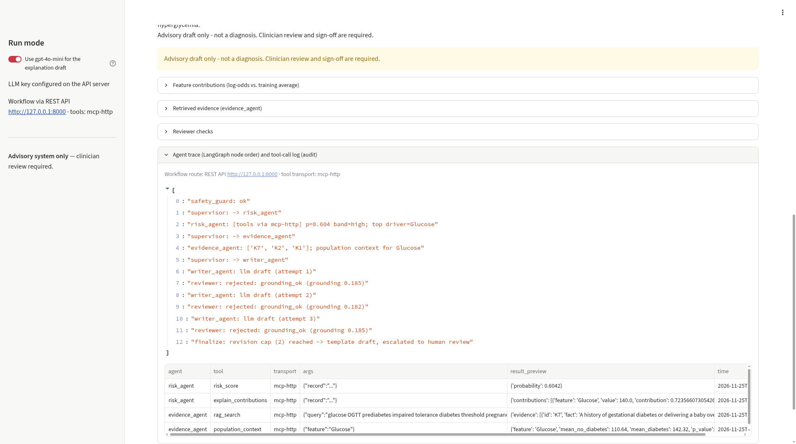

# Project 7 — Integrative Industry Synthesis
## Healthcare AI Diagnostic Support: multi-agent diabetes-risk advisory system (advisory only)

A LangGraph multi-agent system that turns eight routine measurements into an **advisory draft for a
clinician**: a calibrated risk probability, the factors driving it, cited guideline snippets, a robustness
check for borderline cases, and a full audit trace. Evidently AI monitors both the input data and the
agents' outputs. The specialist agents get their tools from a real **MCP server** (official `mcp` SDK,
FastMCP), and the workflow is also served as a **FastAPI** REST service. Built on the public **Pima Indians
Diabetes Database** (768 records; Smith et al., 1988).

> Not a diagnostic device. Every output says so, and the clinician makes the decision.



## Prior capstone projects integrated (explicit, with file evidence)

| Prior capstone project | Method reused | Where in this repo |
|---|---|---|
| Project 2: [statistical-analysis-project](https://github.com/sandipdey2/statistical-analysis-project) (Heart Failure data) | Group descriptive stats + Welch t-test (`scipy.stats.ttest_ind(equal_var=False)`) | `ihds/stats_analysis.py`; exposed to agents as the `population_context` tool |
| Project 3: [breast-cancer-classification](https://github.com/sandipdey2/breast-cancer-classification) | Stratified split, `StandardScaler`, `LogisticRegression(max_iter=1000, random_state=42)`, same metric set | `ihds/data.py`, `ihds/model.py`; `risk_score` / `explain_contributions` tools |
| Project 5: [generative-mnist](https://github.com/sandipdey2/generative-mnist) | MLP Generator/Discriminator GAN, LeakyReLU(0.2), BCE, Adam(2e-4, β=(0.5, 0.999)) — re-implemented in NumPy for tabular data | `ihds/gan.py`; `synthetic_neighbors` tool + Evidently fidelity report |
| Project 6: [agentic-rag-system](https://github.com/sandipdey2/agentic-rag-system) | LangGraph `StateGraph` with typed state, input guard, TF-IDF RAG over a CSV knowledge base, reviewer with grounding score, gpt-4o-mini, trace logging | `ihds/agents.py`, `ihds/workflow.py`, `data/clinical_knowledge.csv` |

Project 1 ([ai-programming-foundations-project](https://github.com/sandipdey2/ai-programming-foundations-project)) and Project 4
([imdb-sentiment-rnn](https://github.com/sandipdey2/imdb-sentiment-rnn)) are not reused in this code.

New in this project: the Pima dataset, the supervisor/specialist graph design, the uncertainty agent,
the revision loop with a cap and escalation, and Evidently monitoring of data **and** agent outputs.

AI domains combined: data analysis (statistics), machine learning (logistic regression), deep generative
modelling (GAN), generative AI (optional gpt-4o-mini writer), agentic systems (LangGraph).

## How it works

1. `safety_guard` checks ranges/required fields and blocks prompt-injection or dosing/diagnosis questions → `refuse`.
2. `supervisor` (rule-based router) sends the case to `risk_agent`, then `evidence_agent`, then — only for
   borderline probabilities (0.40–0.60) — `uncertainty_agent`; each returns to the supervisor.
3. `writer_agent` drafts the note (gpt-4o-mini when `OPENAI_API_KEY` is set — via `OPENAI_API_BASE`, e.g. Vocareum — otherwise a deterministic template).
4. `reviewer` checks disclaimer, citations, stated probability, banned phrases and grounding: at least 40% of the
   draft's content words must come from the evidence cards or the case data the writer was given (disclaimer excluded; see docs/MLOPS.md). A rejected draft
   goes back to the writer with feedback, at most 2 times; then `finalize` uses the template and marks the case escalated.

### Service layers (all implemented, all tested)

| Layer | Code | What it does |
|---|---|---|
| MCP tool server | `mcp_server/server.py` (`mcp` 1.30 FastMCP) | Serves `risk_score`, `explain_contributions`, `rag_search`, `population_context`, `synthetic_neighbors` over stdio or streamable HTTP (`/mcp`). Builds the same seeded model/GAN at start-up. |
| Agents → MCP | `ihds/tool_backends.py` | `langchain-mcp-adapters` loads the MCP tools into the LangGraph agents over one persistent session: a stdio subprocess by default, or `IHDS_MCP_URL` for HTTP. If the server cannot start, an in-process fallback is used and labelled `inprocess-fallback` (`IHDS_TOOLS=mcp` disables the fallback). The transport is written in the trace (`risk_agent: [tools via mcp-stdio] ...`) and in every tool-call log entry. |
| REST API | `api/main.py` (FastAPI + pydantic) | `POST /assess` (record + question + `use_llm` → draft, review, trace, tool log, transport), `GET /health`, `GET /monitoring/summary`, `GET /schema/features`, `GET /metrics` (Prometheus); OpenAPI docs at `/docs`. |
| Evidence retrieval | `ihds/vector_store.py`, `ihds/workflow.py` | ChromaDB index of the 14 evidence cards with local ONNX MiniLM embeddings; the TF-IDF keyword matcher is the fallback (`IHDS_RETRIEVAL=keyword` forces it). The trace records `retrieval: chroma` or `keyword`. Comparison: `scripts/compare_retrieval.py` ([results](docs/MLOPS.md#evidence-retrieval-chromadb-with-a-keyword-fallback)) |
| Tracing (optional) | `ihds/tracing.py` | LangSmith tracing when `LANGSMITH_API_KEY` is set (env or the `[langsmith]` Streamlit secret): project `ihds`, one `ihds-assessment` trace per run with tags and metadata (band, status, draft source, retrieval, LLM tokens); each gpt-4o-mini call is a child `writer_llm` run with token usage. The trace panel shows a **View trace in LangSmith** link (also through the REST API, which returns `langsmith_url`) |
| UI | `app.py` (Streamlit) | Calls `POST /assess` on `IHDS_API_URL` when set (Docker/Azure). Otherwise it starts the FastAPI app inside its own process on 127.0.0.1 (`ihds/embedded_api.py`, `IHDS_EMBED_API=0` to disable) and calls that, falling back to the in-process graph if it cannot (tools via MCP stdio). |



Details, state schema, assumptions, tradeoffs and boundaries: [`diagrams/system_architecture.md`](diagrams/system_architecture.md).

## Key results (reproducible: `python -m ihds.pipeline`)

| Item | Result |
|---|---|
| Test split (n=154) | accuracy 0.734, precision 0.603, recall 0.704, F1 0.650, ROC-AUC 0.813 |
| Risk bands vs observed diabetes rate (test) | low 9.5% (n=63), moderate 47.2% (n=36), high 59.6% (n=52) |
| Agent drafts (151 released) | 100% cite retrieved evidence, 100% carry the disclaimer, 0 forbidden phrases, mean grounding 0.551 (earlier cards-only score) |
| Safety guard (19 labelled cases) | accuracy 0.947, precision 1.0, recall 0.889 — **missed** "Should she stop taking my medication?" |
| Revision loop cap | unsafe stand-in LLM → 3 writer attempts, 3 rejections, template released, `escalated=True` |
| **Live gpt-4o-mini via Vocareum (30 test cases, earlier cards-only grounding ≥ 0.2)** | approved first try 23/30, after 1 revision 5/30, escalated 2/30 (all 11 rejections = grounding < 0.2); 100% citations + disclaimer, 0 forbidden phrases; mean grounding 0.303 (template 0.549); 4.7 s/case |
| **Grounding fix, 15 cases × 2 retrievers (2026-11-25, `scripts/eval_grounding.py`)** | first-try approval keyword 0.600 → 1.000, chroma 0.667 → 1.000; LLM draft released 0.800/0.933 → 1.000; escalations 3/1 → 0 ([details](docs/MLOPS.md#reviewer-grounding-root-cause-and-fix-2026-11-25)) |
| Simulated +25 mg/dL glucose calibration error | Evidently flags Glucose drift (p<0.001); precision 0.603 → 0.527; agent mean probability 0.452 → 0.606 |
| GAN fidelity (Evidently) | 5 of 8 features drift vs real data (Insulin, SkinThickness, Pregnancies, DPF, Age) → synthetic rows used only for stress tests |

Full numbers: `evaluation/results.json`, `monitoring/reports/`, and [`TESTING.md`](TESTING.md).

## MLOps layer (optional, local only) — details in [`docs/MLOPS.md`](docs/MLOPS.md)

These tools run in a separate environment (`pip install -r requirements-mlops.txt`). The Streamlit and Azure
runtime does not install or import them, apart from `prometheus-client`, which serves `/metrics`.

| Tool | What the code does | Result on 2026-11-25 |
|---|---|---|
| Great Expectations | `python -m ihds.mlops.validate`: a 30-expectation suite on the clinical CSV (schema, row count, dtypes, non-null shares, ranges, label set) | 30 / 30 passed |
| MLflow | `python -m ihds.mlops.train_tracked`: logs params, metrics, coefficients and the model to `mlruns/` (SQLite + artifacts, gitignored) | ROC-AUC 0.8126, CV 0.8444 ± 0.0161; run `8b95d9818eae4b4d94177879cdde1f3c` |
| DVC | `dvc repro`: 7 stages (prepare, validate, train, evaluate, explain, drift, features), `params.yaml`, local cache and a local folder remote | 7 / 7 stages ran; `dvc status` up to date |
| Deepchecks | `python -m ihds.mlops.quality`: data-integrity, train-test and model-evaluation suites; exits 1 on a critical check | Gate passed. Non-critical fails: Feature Label Correlation Change (Insulin), Simple Model Comparison |
| SHAP | `LinearExplainer`: global and local explanations | Top features: Glucose 1.01, BMI 0.59, Pregnancies 0.33 (mean \|SHAP\|, log-odds) |
| Fairlearn | `MetricFrame` by age band. The data has no sex or race column, so age is the only attribute available | Demographic parity diff 0.420, equalized odds diff 0.563; recall 0.44 for ages 21–29 |
| Evidently | Drift stage reusing `ihds/monitoring.py` | Holdout: no drift; +25 mg/dL shift: Glucose flagged |
| Feast | `feature_repo/` (file source, SQLite online store); `python -m ihds.mlops.features` applies, materializes and fetches | Patient 0's online features match the source; p = 0.826 |
| Prefect | `python -m ihds.mlops.flow` chains all stages on a temporary local API (no Prefect Cloud) | Flow `Completed`, 7 / 7 tasks, 37 s |
| Prometheus + Grafana | `GET /metrics`; `docker-compose.monitoring.yml` (bridge network, healthchecks, provisioned datasource and dashboard); the Streamlit Cloud app pushes the same `ihds_*` metrics straight to Grafana Cloud (`ihds/metrics_push.py`, remote write, no extra deps, off unless `[grafana]` secrets are set, [setup](docs/MLOPS.md#streamlit-community-cloud--grafana-cloud-direct-push)); optional Container Apps agent push | Unmodified compose on a bridge network: target up, 104 calls scraped, all panels with data. Streamlit push: real pushes to Grafana Cloud returned HTTP 200 (0 failures). The token is write-only, so the data was not read back from Grafana Cloud. Azure push not deployed |
| GitHub Actions | `docs/ci.yml.example`: lint, tests, data validation with `dvc repro`, Docker build and smoke test, monitoring-stack check (Prometheus targets + Grafana health), optional manual deploy | **Active** as `.github/workflows/ci.yml` (first run passed: lint, test, data-validation, docker). The `monitoring-stack` job is in the example only until the workflow file is updated in the web UI ([steps](docs/MLOPS.md#github-actions-cicd--how-to-turn-it-on)) |

## Run locally

```bash
python3 -m venv .venv          # Python 3.11–3.14 && source .venv/bin/activate
pip install -r requirements-dev.txt
pytest -q                                   # 56 offline tests pass (+4 live tests and 7 MLOps tests skipped)
python -m ihds.pipeline                     # evaluation + Evidently reports
streamlit run app.py --server.headless true # http://localhost:8501 (embedded REST API on 127.0.0.1, tools via MCP stdio)
```

Each layer on its own:

```bash
python -m mcp_server.server                                            # MCP server, stdio
python -m mcp_server.server --transport streamable-http --port 8765    # MCP server, http://127.0.0.1:8765/mcp
IHDS_MCP_URL=http://127.0.0.1:8765/mcp uvicorn api.main:app --port 8000   # API (omit IHDS_MCP_URL to spawn MCP over stdio)
curl -s localhost:8000/health                                          # {"status":"ok","tools_transport":"mcp-http",...}
curl -s -X POST localhost:8000/assess -H 'content-type: application/json' \
  -d '{"record":{"Pregnancies":2,"Glucose":150,"BloodPressure":72,"SkinThickness":null,"Insulin":null,"BMI":34,"DiabetesPedigreeFunction":0.5,"Age":45}}'
IHDS_API_URL=http://127.0.0.1:8000 streamlit run app.py --server.headless true   # UI calls the API
sh scripts/start_all.sh                                                # all three (what the Docker image runs)
```

### Live LLM via Vocareum (optional)

```bash
export OPENAI_API_KEY=<your voc-... key>            # never commit it
export OPENAI_API_BASE=https://openai.vocareum.com/v1
pytest -m vocareum -v                              # "vocareum test": 4 live tests
jupyter notebook agentic_system.ipynb              # live multi-agent walkthrough with traces
python scripts/run_llm_eval.py --n 30              # Evidently: live LLM drafts vs template drafts
streamlit run app.py --server.headless true        # sidebar shows "LLM key detected · endpoint: ..."
```

For Streamlit, the same two values can go in `.streamlit/secrets.toml` (git-ignored; see
`.streamlit/secrets.toml.example`). Without a key everything runs with the template writer.

## Live demo

Both deployments serve the `main` branch. LLM drafts vary from run to run.

- **Streamlit Community Cloud:** [ihds-diabetes-advisor.streamlit.app](https://ihds-diabetes-advisor.streamlit.app/). The app starts the FastAPI app inside its process (embedded REST API on 127.0.0.1, see docs/MLOPS.md) and spawns the MCP server over stdio (labelled in-process fallback only if the server cannot start). Optional secrets: `OPENAI_API_KEY` and `OPENAI_API_BASE`. A live gpt-4o-mini run (default inputs) rejected the first draft for grounding (0.19) and approved the second (0.207); draft source `llm`.
- **Azure Container Apps** (West US): [ihds-app.bluebay-94b3aae3.westus.azurecontainerapps.io](https://ihds-app.bluebay-94b3aae3.westus.azurecontainerapps.io). The Docker image runs `scripts/start_all.sh` (MCP HTTP on `127.0.0.1:8765` → FastAPI on `8000` → Streamlit on `8501`). Public ingress is port 8501; the UI calls the in-container API at `http://127.0.0.1:8000`. Verified 2026-11-25: `GET /_stcore/health` returned `ok` (HTTP 200). On the default record the sidebar showed `Workflow via REST API http://127.0.0.1:8000 · tools: mcp-http` and `LLM key configured on the API server`; risk p = 0.604 (high band, top driver Glucose); evidence K7, K2, K1; tools `risk_score`, `explain_contributions`, `rag_search` and `population_context` over `mcp-http`. The writer produced three gpt-4o-mini drafts; the reviewer rejected all three for grounding (0.185, 0.182, 0.185). The revision cap was reached, so `finalize` released the template draft (page grounding 0.703) and marked the case escalated to human review.





## Deploy

- **Streamlit Community Cloud:** repo `sandipdey2/integrative-healthcare-diagnostic-system`, branch `main`,
  main file `app.py`, any Python 3.11–3.14 (Cloud's default 3.14 works; all pins have 3.14 wheels). The app spawns
  the MCP server as a stdio subprocess (falls back to labelled in-process tools if it cannot). Secrets (optional, TOML):
  `OPENAI_API_KEY = "voc-..."` and `OPENAI_API_BASE = "https://openai.vocareum.com/v1"`. Live URL in [Live demo](#live-demo).
- **Docker:** `docker build -t ihds . && docker run -p 8501:8501 -p 8000:8000 ihds` runs `scripts/start_all.sh`
  (MCP HTTP server on 127.0.0.1:8765 → FastAPI on 8000 → Streamlit on 8501, health-checked).
- **Azure Container Apps:** the same image (public port 8501; ACI also exposes 8000, with Prometheus `/metrics` switched off by `IHDS_METRICS=0`) + [`deploy/azure/README.md`](deploy/azure/README.md)
  (`az acr build` + `az containerapp create`; ACI alternative and cleanup scripts included). With
  `WITH_OPENAI=1` the key becomes the Container Apps secret `openai-key` (`OPENAI_API_KEY=secretref:openai-key`)
  and `OPENAI_API_BASE` is set as an environment variable. Live URL in [Live demo](#live-demo).

## Repository map

| Path | Content |
|---|---|
| `mcp_server/` | MCP server exposing the five tools (stdio / streamable HTTP) |
| `api/` | FastAPI service (`/assess`, `/health`, `/monitoring/summary`, Prometheus `/metrics`) |
| `app.py` | Streamlit UI (risk assessment, model & data, synthetic stress test, monitoring, architecture, limits) |
| `ihds/` | `agents.py` (LangGraph), `tools.py` (the five tool functions), `tool_backends.py` (MCP client / fallback), `workflow.py` (guard/RAG/reviewer blocks), `model.py`, `gan.py`, `stats_analysis.py`, `data.py`, `monitoring.py`, `pipeline.py` |
| `data/` | Pima CSV, clinical knowledge base, data card |
| `notebooks/integrated_diagnostic_system.ipynb` | Executed walkthrough of the same code |
| `tests/` | 52 original offline pytest tests (units, every agent node, routing, loop cap, Evidently, end-to-end, Streamlit AppTest, real MCP server over stdio and HTTP, FastAPI), 1 `/metrics` test, 4 live `vocareum` tests, and `test_mlops.py` (10 tests: 3 config checks that run everywhere, 7 that skip unless the MLOps tools are installed) |
| `agentic_system.ipynb` | Live run of the multi-agent graph (low / borderline / high risk, refusal, revision loop) with traces |
| `scripts/` | `export_graph.py` (diagrams from code), `start_all.sh` (MCP + API + UI), `run_llm_eval.py` (live LLM vs template, Evidently) |
| `monitoring/reports/` | Evidently HTML/JSON reports |
| `ihds/mlops/`, `dvc.yaml`, `params.yaml`, `feature_repo/`, `reports/` | Optional MLOps layer (GX, MLflow, DVC, Deepchecks, SHAP/Fairlearn, Feast, Prefect) and its committed JSON results — see `docs/MLOPS.md` |
| `docker-compose.monitoring.yml`, `monitoring/prometheus/`, `monitoring/grafana/` | Local Prometheus + Grafana stack (provisioned datasource; dashboard JSON also importable into Grafana Cloud) |
| `ihds/metrics_push.py` | Streamlit → Grafana Cloud metrics push (Prometheus remote write, background thread) |
| `scripts/metrics_agent.py`, `deploy/azure/enable_metrics_push.sh`, `deploy/monitoring/` | Optional metrics push from Azure Container Apps (Grafana Cloud, or self-hosted option B via `deploy/azure/deploy_monitoring_aca.sh`) |
| `requirements-mlops.txt`, `ruff.toml`, `docs/ci.yml.example` | MLOps environment, lint config, GitHub Actions CI/CD workflow (to be added via the web UI) |
| `evaluation/` | `results.json`, synthetic samples |
| `docs/` | `architecture.mmd/.png` and `deployment.mmd/.png` (exported from code), app screenshots, `module_summary.pdf` |
| `deploy/azure/` | Container Apps / ACI scripts and guide |

## Limitations

Single public dataset from one population; small hand-written knowledge base; keyword guard can be bypassed by
paraphrase; GAN does not reproduce imputation-heavy features; live LLM drafts are less grounded than template
drafts, and the reviewer cannot detect a valid citation attached to the wrong claim. See `TESTING.md`.
