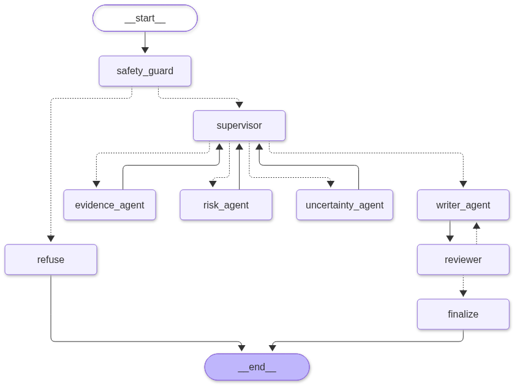

# System Architecture (as implemented)

The agent graph image is exported **from the compiled LangGraph object** by `scripts/export_graph.py`
(`graph.get_graph().draw_mermaid()` → `docs/architecture.mmd`, `draw_mermaid_png()` → `docs/architecture.png`).
A unit test (`tests/test_agents.py::test_graph_structure_matches_docs`) fails if the `.mmd` file and the code diverge.



Solid arrows are fixed edges; dotted arrows are conditional edges.

## 1. Start-up path (`ihds/pipeline.py::build_system`, runs once per process)

```
data/pima_diabetes.csv
  │ ihds/data.py         zeros in Glucose/BloodPressure/SkinThickness/Insulin/BMI -> missing; stratified 80/20 split (seed 42)
  ├─► ihds/stats_analysis.py  Welch t-tests per feature (diabetic vs non-diabetic)         [statistical-analysis-project]
  ├─► ihds/model.py           median impute -> StandardScaler -> LogisticRegression          [breast-cancer-classification]
  ├─► ihds/gan.py             NumPy GAN on imputed training rows -> 500 + 2000 synthetic rows [generative-mnist]
  └─► ihds/agents.py          LangChain tools wrap the 4 components above; StateGraph compiled [agentic-rag-system]
```

## 2. Request path: LangGraph `StateGraph` (`ihds/agents.py`)

Shared typed state: `AgentState` (TypedDict) with record, question, guard result, probability/band,
contributions, evidence, population context, uncertainty, draft, review, revision counter, escalation flag,
and append-only `trace` and `tool_calls` lists (reducer `operator.add`).

| Node | Kind | What it does | Tools / model |
|---|---|---|---|
| `safety_guard` | guardrail agent | Normalises raw zeros, checks ranges / required fields, blocks prompt-injection and dosing/diagnosis questions | rules (`workflow.input_guard`) |
| `refuse` | terminal | Returns the refusal text | — |
| `supervisor` | router agent | Picks the next specialist from what is missing in state: risk → evidence → (uncertainty if 0.40 ≤ p < 0.60) → writer | rules |
| `risk_agent` | specialist | Probability, band, per-feature log-odds contributions | `risk_score`, `explain_contributions` (LR pipeline) |
| `evidence_agent` | specialist | Top-3 knowledge snippets + population statistics for the top driver | `rag_search` (TF-IDF), `population_context` (Welch results) |
| `uncertainty_agent` | specialist | Probability spread over the 25 nearest GAN-generated profiles | `synthetic_neighbors` (GAN pool) |
| `writer_agent` | generator | Advisory draft; uses reviewer feedback on revisions | gpt-4o-mini via `langchain-openai` if `OPENAI_API_KEY` is set (base URL from `OPENAI_API_BASE`, e.g. Vocareum), else deterministic template |
| `reviewer` | critic agent | Disclaimer, `[K#]` citations of retrieved ids, exact probability, banned phrases, grounding ≥ 0.2 | rules (`workflow.review`) |
| `finalize` | terminal | Releases approved draft; if the cap is hit, swaps in the template draft and sets `escalated=True` | — |

Edges: `START → safety_guard`; `safety_guard ⇢ refuse | supervisor`; `supervisor ⇢ risk_agent | evidence_agent |
uncertainty_agent | writer_agent`; each specialist `→ supervisor` (hub-and-spoke loop); `writer_agent → reviewer`;
`reviewer ⇢ writer_agent` (revision loop, at most `MAX_REVISIONS = 2` times, so the writer runs ≤ 3 times) `| finalize`;
`finalize → END`; `refuse → END`. `recursion_limit = 30`.

## 3. Monitoring and evaluation path (`ihds/monitoring.py`, Evidently 0.7.23)

| Report | Reference | Current | Evidently content |
|---|---|---|---|
| holdout | train split + predictions | test split + predictions | DataDriftPreset + ClassificationPreset |
| shifted | train split + predictions | test split with **simulated** +25 mg/dL glucose (labels unchanged) | DataDriftPreset + ClassificationPreset |
| synthetic | imputed train rows | 500 GAN rows | DataDriftPreset (generator fidelity) |
| agent_text_eval | — | 151 released drafts from the graph on the test split | TextEvals (length, sentences, citation regex, disclaimer, forbidden phrases) + ClassificationPreset |
| agent_output_drift | agent outputs on test split | agent outputs on the glucose-shifted test split | DataDriftPreset on probability, grounding, revisions, tool calls, words |
| guard_eval | — | 19 labelled guard cases | ClassificationPreset (expected vs predicted blocked) |

Outputs: `monitoring/reports/*_report.{html,json}`, `summary.json`, `agent_eval_summary.json`.

## Honest scope

- The supervisor routes by **rules**, not by an LLM; the LLM (when enabled) only writes the draft text.
- Tools are LangChain `StructuredTool`s called in-process; there is no MCP server or remote tool service.
- All agents run in one Python process and share one state object; there is no message bus or memory store
  beyond the per-request state (no cross-session memory).
- Without an API key the writer is a template, so offline runs never take the revision loop. With the live
  gpt-4o-mini writer the loop fires naturally (11 grounding rejections in a 30-case live run, 2 escalations);
  tests also exercise it with an offline stand-in model.
- No EHR integration, authentication, or storage of patient inputs.

## Assumptions

- Inputs are the 8 Pima measurements; Glucose is a 2-hour OGTT value (mg/dL).
- Population: females 21+ of Pima heritage (see `data/README.md`); results may not transfer.
- The 14-row knowledge base is a hand-written summary of public guidance, not exhaustive.

## Tradeoffs

- Logistic regression: exact, auditable contributions for explanations; test ROC-AUC 0.813.
- `class_weight="balanced"`: recall 0.704 vs precision 0.603 — a missed diabetic case is costlier than an extra test.
- Rule-based supervisor: deterministic, testable routing; less flexible than LLM routing.
- NumPy GAN instead of PyTorch: smaller image; weaker fidelity on Insulin/SkinThickness.
- Template writer by default: reproducible and free; the LLM writer is more fluent but must pass the reviewer.
- Keyword guard: transparent and fast but brittle against paraphrases (1 miss in 19 labelled cases).

## System boundaries

- In: one patient's 8 numeric features + optional question (Streamlit form).
- Out: advisory text with probability, band, drivers, cited evidence, disclaimer, agent trace and tool log.
- Out of scope: diagnosis, treatment/dosing advice, imaging, real patient data.
