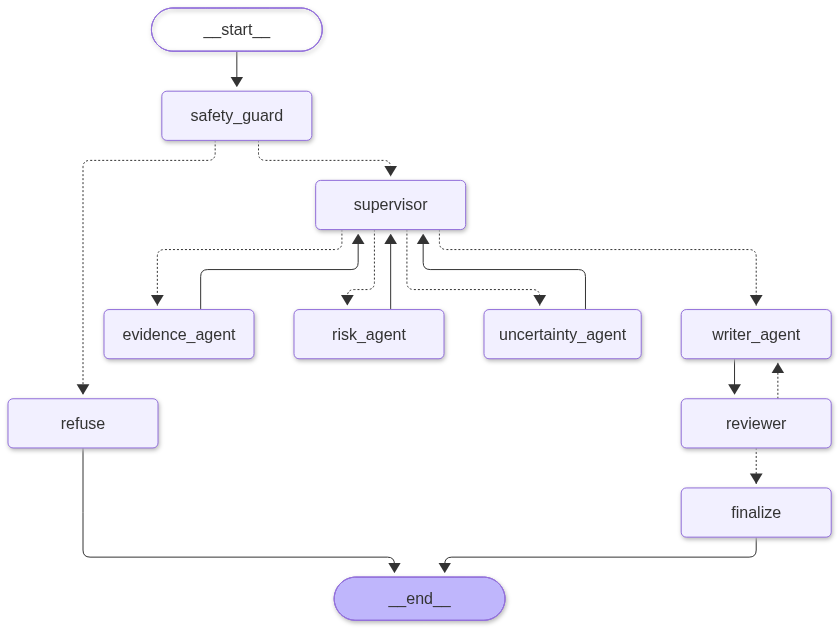

# Healthcare AI Diagnostic Support: A Multi-Agent Diabetes-Risk Advisory System

**Integrative Industry Synthesis — Module Summary** · Sandip Dey · November 2026  
Repository: github.com/sandipdey2/integrative-healthcare-diagnostic-system

## Overview and Industry Context

Type 2 diabetes is frequently undiagnosed for years, and screening in primary care depends on clinicians interpreting routine measurements under time pressure. Current guidance recommends screening adults with overweight or obesity from age 35 and confirming diagnosis with standard laboratory criteria (American Diabetes Association Professional Practice Committee [ADA], 2024; US Preventive Services Task Force, 2021). Early identification matters because lifestyle intervention reduced the incidence of diabetes by 58% in people at high risk (Diabetes Prevention Program Research Group, 2002).

I built a decision-support prototype for this screening and triage setting. A clinician enters eight routine measurements (pregnancies, 2-hour glucose, blood pressure, skin-fold thickness, insulin, BMI, diabetes pedigree function and age), and a LangGraph multi-agent workflow returns an **advisory draft**: a risk probability and band, the factors driving it, cited guideline snippets, a robustness check for borderline cases and a full audit trace of every agent step and tool call. The system never issues a diagnosis or treatment advice; every output says so and the clinician decides.

The data are the public Pima Indians Diabetes Database (Smith et al., 1988): 768 records of women aged 21 and over of Pima heritage, 268 (34.9%) with diabetes. The healthcare setting imposes the main constraints: errors have clinical consequences, the population is narrow, records are incomplete (48.7% of Insulin values are recorded as impossible zeros), and regulators expect clinicians to be able to review the basis of any recommendation (US Food and Drug Administration [FDA], 2022).

## Integration Rationale

The system is new work, but each core component deliberately reuses a method I developed in an earlier capstone project. The integration is explicit in the code: each method is a module, and each module is exposed to the agents as a named tool.

| Prior project | Method reused | Location in this repo | Agent tool |
|---|---|---|---|
| Project 2 — [statistical-analysis-project](https://github.com/sandipdey2/statistical-analysis-project) | Group descriptive statistics and Welch t-tests | `ihds/stats_analysis.py` | `population_context` |
| Project 3 — [breast-cancer-classification](https://github.com/sandipdey2/breast-cancer-classification) | Stratified split, StandardScaler, LogisticRegression (max_iter=1000, random_state=42), same metric set | `ihds/data.py`, `ihds/model.py` | `risk_score`, `explain_contributions` |
| Project 5 — [generative-mnist](https://github.com/sandipdey2/generative-mnist) | MLP generator/discriminator GAN (LeakyReLU 0.2, BCE, Adam 2e-4, β = 0.5/0.999), re-implemented in NumPy for tabular data | `ihds/gan.py` | `synthetic_neighbors` |
| Project 6 — [agentic-rag-system](https://github.com/sandipdey2/agentic-rag-system) | LangGraph StateGraph with typed state, input guard, TF-IDF retrieval over a CSV knowledge base, reviewer with grounding score, trace logging | `ihds/agents.py`, `ihds/workflow.py`, `data/clinical_knowledge.csv` | `rag_search` |

My Statistical Analysis project (Project 2) taught me to test group differences before modelling rather than assume them. Here, Welch t-tests confirm that all eight features separate diabetic from non-diabetic patients (p < 1e-5); glucose has the largest effect (142.3 vs 110.6 mg/dL, d = 1.16). The evidence agent quotes these population statistics for the patient's top risk driver.

My Breast Cancer Classification project (Project 3) showed that a scaled logistic regression is a strong, auditable baseline for medical tabular data. I kept that pipeline and metric set, and added `class_weight="balanced"` and median imputation for the impossible zeros.

My Generative MNIST project (Project 5) gave me a working understanding of adversarial training. I re-implemented the same architecture in NumPy for tabular rows and use the generated profiles only as a stress-test population and a neighbourhood for uncertainty checks.

My Agentic RAG project (Project 6) supplied the orchestration pattern: a typed LangGraph state, an input guard, retrieval with citations and a reviewer that scores grounding before an answer is released.

Together, these cover five AI domains: statistical analysis, machine learning, deep generative modelling, generative AI (an optional LLM writer) and agentic systems, each with a specific clinical job.

## System Design and Technical Decisions

Figure 1 (below) is exported from the compiled graph by `scripts/export_graph.py`, and a unit test fails if it and the code diverge—a direct response to earlier feedback that my diagrams overstated the code.

At start-up, `ihds/pipeline.py` loads and cleans the data, runs the statistics, trains the model and the GAN. The five tools run in a separate MCP server (`mcp_server/server.py`, official `mcp` SDK), which the agents reach through `langchain-mcp-adapters` over stdio or HTTP; a FastAPI service exposes the workflow as `POST /assess`. Each request then flows through the graph with one shared typed state (`AgentState`) containing append-only `trace` and `tool_calls` lists:

1. `safety_guard` normalises zeros, checks ranges and required fields, and blocks prompt-injection and dosing or diagnosis questions, sending them to `refuse`.
2. A rule-based `supervisor` routes in hub-and-spoke fashion: `risk_agent` (probability, band, per-feature log-odds contributions), then `evidence_agent` (top-3 TF-IDF knowledge snippets plus population statistics), then `uncertainty_agent` only when 0.40 ≤ p < 0.60 (probability spread across the 25 nearest GAN profiles). Each specialist returns to the supervisor.
3. `writer_agent` drafts the note with gpt-4o-mini via `langchain-openai` (temperature 0) when `OPENAI_API_KEY` is set; otherwise it uses a deterministic template.
4. `reviewer` checks the disclaimer, `[K#]` citations of retrieved evidence, the exact probability, banned phrases and a grounding score of at least 0.2. A rejected draft returns to the writer with feedback at most twice (`MAX_REVISIONS = 2`). After that, `finalize` releases the safe template and marks the case `escalated` for human review.

**Key decisions and tradeoffs.** Logistic regression was chosen over more flexible models because its log-odds contributions are exact, which makes the explanations faithful rather than approximate (Amann et al., 2020). The cost is a ceiling on accuracy (test ROC-AUC 0.813). Class balancing trades precision for recall because, in screening, a missed case usually costs more than an extra confirmatory test. The supervisor uses rules rather than an LLM, so routing is deterministic and every path can be tested; the cost is less flexibility for unanticipated requests. The LLM only writes text and is optional, so the system also runs offline and reproducibly.

**Honest scope.** The agent graph runs in one process; only the tools are remote, over MCP. An in-process fallback is used, and labelled in the trace, only if the MCP server cannot start. There is no message bus and no memory beyond the single request. The gpt-4o-mini writer was verified live through Vocareum's OpenAI-compatible endpoint (results below); without a key the template writer is used, and the scenario results above it come from template runs. The API and MCP server have no authentication, and nothing stores patient inputs.

## Ethical Considerations and Responsible AI

**Bias and generalisability.** The model learned from one population of Pima women. Diabetes prevalence, body composition and glucose distributions differ by ancestry, sex and age, so the probabilities are not validated for men, other ethnic groups or younger patients. The data card and the app state this explicitly.

**Automation bias and accountability.** Clinicians may over-trust a confident number. My evaluation includes a diabetic patient scored at p = 0.077, which shows why the output is framed as an advisory draft: it reports a band and drivers rather than a verdict, includes a mandatory disclaimer that the reviewer verifies, and leaves the decision with the clinician. This matches the FDA (2022) expectation that clinicians can independently review the basis of non-device decision support.

**Transparency.** Each output shows the exact feature contributions, cites retrieved evidence by identifier and includes the agent trace and tool log. Explainability in healthcare is a clinical, legal and ethical requirement, not only a technical one (Amann et al., 2020).

**Misuse.** The safety guard blocks dosing and diagnosis requests, and the reviewer rejects banned phrases such as "you have diabetes" before any LLM text is released.

**Responsible deployment safeguards.** Real-world use would require external and subgroup validation, an intent classifier instead of the keyword guard, Evidently alerts with named owners, clinical sign-off on the knowledge base, authentication with audit logging, and a regulatory device assessment. Monitoring is part of the design because deployed models accumulate hidden maintenance and data-dependency risks (Sculley et al., 2015).

## Evaluation and Reflection

Template-mode results are reproducible with `python -m ihds.pipeline` (seed 42). All 56 automated tests pass, including real MCP and API tests and four live Vocareum tests.

**Model.** On the held-out test set (n = 154), the model reached accuracy 0.734, precision 0.603, recall 0.704, F1 0.650 and ROC-AUC 0.813. Training ROC-AUC was 0.851 (limited overfitting). Glucose (odds ratio 3.27 per SD) and BMI (2.03) dominate, which is clinically plausible.

**Workflow scenarios.** Of 154 test records, 151 were released and 3 were correctly blocked for missing BMI. The reviewer approved all 151 drafts (mean grounding 0.551). Risk bands were ordered as intended: observed diabetes rates were 9.5% in the low band, 47.2% in the moderate band and 59.6% in the high band. All 27 borderline cases were routed to the uncertainty agent. With an always-unsafe stand-in LLM, the revision cap held: three writer attempts were made, the template was released and the case was escalated.

**Evidently monitoring.** On the hold-out data, 0 of 8 features drifted. The 151 template drafts had 100% citation and disclaimer rates and no forbidden phrases.

**Live LLM writer.** On 30 held-out cases run live with gpt-4o-mini, the reviewer approved 23 drafts first time and 5 after one revision; 2 cases hit the cap and were escalated with the template. All 11 rejections were for grounding below 0.2. Evidently found 100% citation and disclaimer rates and no forbidden phrases, but LLM drafts were less grounded than template drafts (mean 0.303 vs 0.549) and took 4.7 s rather than 0.01 s. One draft attached a valid citation to an unrelated claim, which the reviewer cannot detect.

**Did the system meet its goals?** Mostly. It produces grounded, explainable, auditable advisory drafts, blocks incomplete records and fails safely when the writer misbehaves. It does not reach diagnostic-grade accuracy, which was never the aim.

**Failure cases.**

1. *Guard paraphrase miss.* On 19 labelled cases, the guard scored accuracy 0.947, precision 1.0 and recall 0.889. It allowed "Should she stop taking my medication?" because the keyword pattern did not match the paraphrase. The template draft still gave no medication advice, but the request should have been refused.
2. *Glucose-sensor drift.* A simulated +25 mg/dL calibration error was flagged by Evidently (Glucose drift, p < 0.001). Recall rose to 0.907, but precision fell from 0.603 to 0.527, meaning more false alarms. Agent-output monitoring also caught the shift: mean probability rose from 0.452 to 0.606 (p = 0.0009) while grounding and revision counts stayed stable. Without monitoring, this degradation would be silent.
3. *Confident false negative.* A diabetic patient with glucose 78 mg/dL, BMI 31 and age 26 received p = 0.077 because low glucose dominates the linear model.
4. *GAN fidelity drift.* Evidently found that 5 of 8 synthetic features drifted from the real data (Pregnancies, SkinThickness, Insulin, DPF and Age). The generator does not reproduce the imputation spikes, so synthetic rows are never used for training.

**Strengths and limitations.** The design is strongest where components check each other: the reviewer constrains the writer, Evidently monitors inputs and outputs, and the GAN probes robustness. Its limitations are a single small dataset, a 14-row hand-written knowledge base, a brittle keyword guard, and LLM drafts that are fluent but less grounded than the template.

**Performance versus responsible use.** A gradient-boosted model or an LLM-routed supervisor might add accuracy or flexibility but would weaken auditability; I chose transparency and safe failure.

## Professional Relevance

This project reflects the work of an applied AI engineer in a regulated industry. It required framing a clinical problem with its constraints, choosing interpretable models deliberately, orchestrating specialised agents with explicit safety checks, monitoring data and model outputs for drift, and documenting honestly what the system does and does not do. The repository includes tested code (56 tests), an MCP tool server, a REST API, Docker, Streamlit and Azure deployment, Evidently reports and a graph diagram tested against the code. Making the architecture match the code reinforced an industry habit: claims must be verifiable from the system itself.

## References

American Diabetes Association Professional Practice Committee. (2024). 2. Diagnosis and classification of diabetes: Standards of Care in Diabetes—2024. *Diabetes Care, 47*(Suppl. 1), S20–S42. https://doi.org/10.2337/dc24-S002

Amann, J., Blasimme, A., Vayena, E., Frey, D., & Madai, V. I. (2020). Explainability for artificial intelligence in healthcare: A multidisciplinary perspective. *BMC Medical Informatics and Decision Making, 20*(1), Article 310. https://doi.org/10.1186/s12911-020-01332-6

Diabetes Prevention Program Research Group. (2002). Reduction in the incidence of type 2 diabetes with lifestyle intervention or metformin. *New England Journal of Medicine, 346*(6), 393–403. https://doi.org/10.1056/NEJMoa012512

Sculley, D., Holt, G., Golovin, D., Davydov, E., Phillips, T., Ebner, D., Chaudhary, V., Young, M., Crespo, J.-F., & Dennison, D. (2015). Hidden technical debt in machine learning systems. *Advances in Neural Information Processing Systems, 28*, 2503–2511.

Smith, J. W., Everhart, J. E., Dickson, W. C., Knowler, W. C., & Johannes, R. S. (1988). Using the ADAP learning algorithm to forecast the onset of diabetes mellitus. *Proceedings of the Annual Symposium on Computer Application in Medical Care*, 261–265.

US Food and Drug Administration. (2022). *Clinical decision support software: Guidance for industry and Food and Drug Administration staff*. https://www.fda.gov/media/109618/download

US Preventive Services Task Force. (2021). Screening for prediabetes and type 2 diabetes: US Preventive Services Task Force recommendation statement. *JAMA, 326*(8), 736–743. https://doi.org/10.1001/jama.2021.12531
